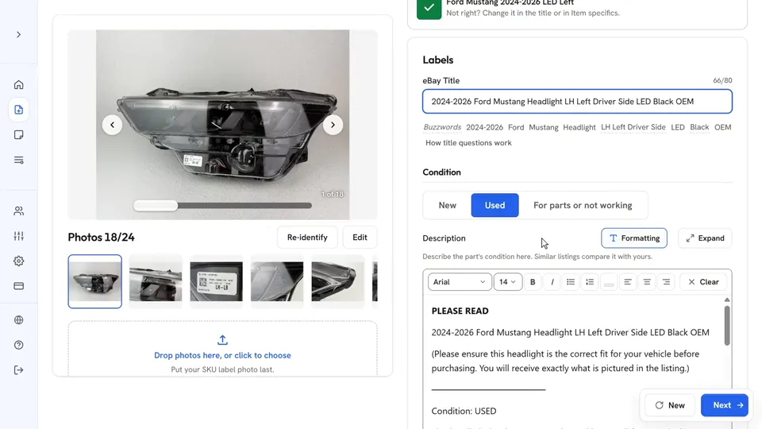
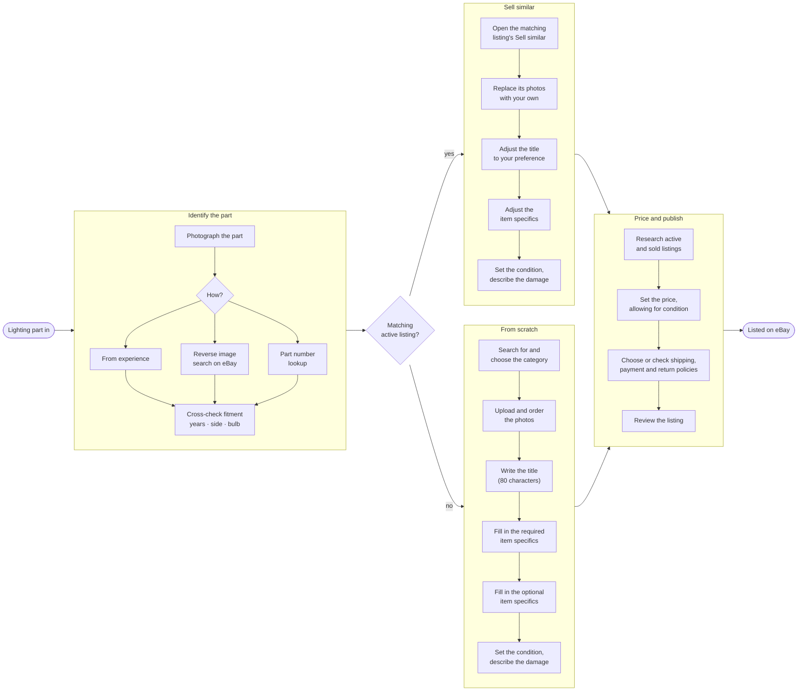
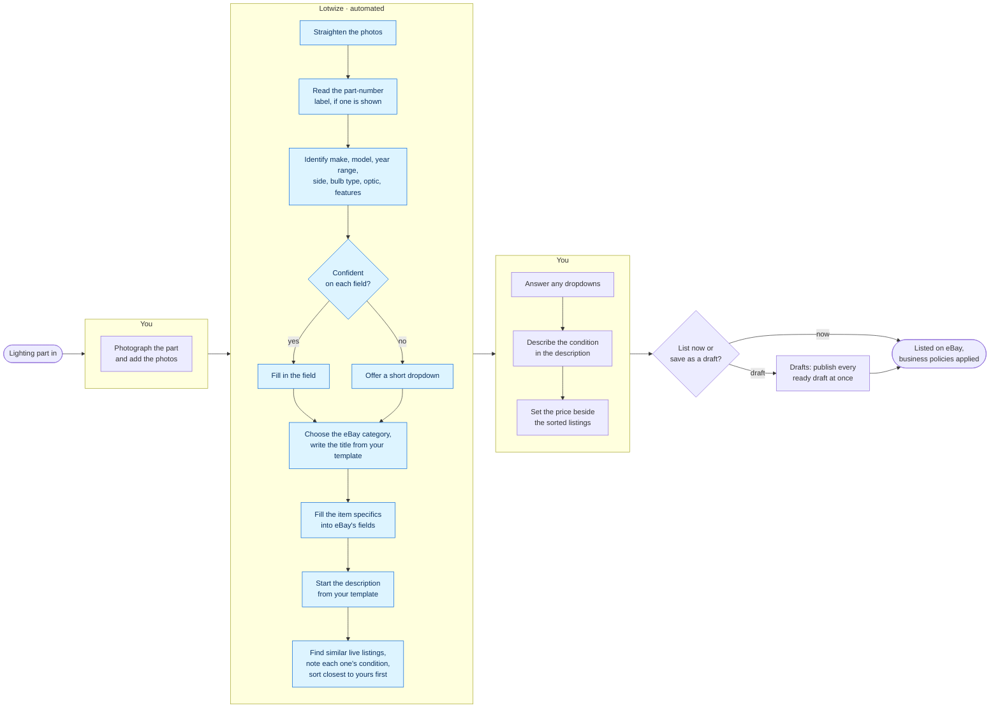
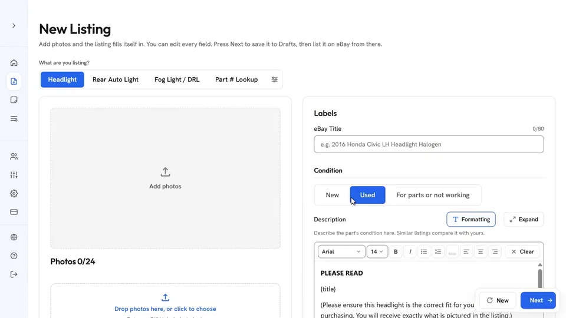
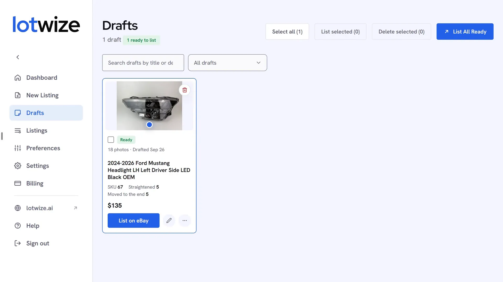
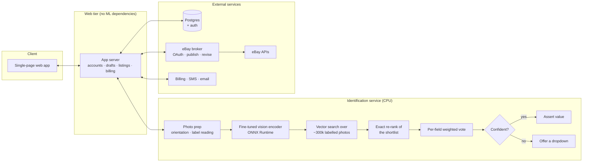

<picture>
  <source media="(prefers-color-scheme: dark)" srcset="assets/wordmark-white.svg">
  
</picture>

Lotwize is the first commercial application to be able to identify a picture of an auto lighting part and complete listing title generation / item specifics while aiding the user in filling in the price relative to the condition.

Besides retrieval-based identification, a new workflow: **Part # Lookup**, was recently added to accelerate listing generation for automotive parts that have the part # clearly displayed in one of the user's photos. Listings are able to personalized to the user's titling patterns as well. 

[**lotwize.ai**](https://lotwize.ai) · [Live benchmarks](https://lotwize.ai/models) · [Try it on your own photo](https://lotwize.ai/demo)

 

 

  

> **About this repository.** Lotwize is a commercial product, so its source code is private. This repository
> describes what it does, how well it does it, and how it is built and tested. Every figure here comes from a dated, hand-checked benchmark, and the
> [method](docs/metrics.md) is described in full.

---

## Contents

- [The problem](#the-problem)
- [Listing by hand vs. with Lotwize](#listing-a-used-headlight-by-hand-and-with-lotwize)
- [What Lotwize does](#what-lotwize-does)
- [Results](#results)
- [How it is built](#how-it-is-built)
- [Engineering practices](#engineering-practices)
- [By the numbers](#by-the-numbers)
- [What is deliberately not here](#what-is-deliberately-not-here)
- [Further reading](#further-reading)

---

## The problem

A medium to large-scale eBay store can find itself listing hundreds to thousands of headlights and tail lights each week. Depending on the workflow used and the user's experience, they may be finding themeselves taking up to three minutes or more listing a single item due to repetitive tasks that can be automated. 

### By hand

**ROUGHLY**

After identifying the part, the seller either copies a matching listing with eBay's "Sell similar" or builds one
from scratch. Every step is manual.

### With Lotwize

The seller adds photos and Lotwize fills the listing. Blue steps are automated. A field the photos can't settle
comes back as a short dropdown instead of a guess. For pricing, Lotwize finds similar live listings, reads each
one's condition, and sorts the closest match to the seller's own condition to the top. Nothing goes live until
the seller presses List.

### Step by step

| Task | By hand | With Lotwize |
|---|---|---|
| Photos | Upload and order them. With Sell similar, replace the copied listing's photos. | **You:** add the photos. **Automated:** they're straightened. |
| Identify | From experience, eBay image search or a part-number lookup, then cross-check the fitment. | **Automated:** make, model, year range, side, bulb, optic and features from the photos, plus the part number from the label. |
| Unsure fields | The seller's own judgment. | **You:** pick from a short dropdown. |
| Category | Search for it and choose. | **Automated:** chosen from the identified part. |
| Title | Write one, or adjust a copied one. | **Automated:** built from the seller's own template. |
| Item specifics | Fill in the required and optional fields. | **Automated:** filled into eBay's fields from the identification. |
| Description | Write it, or edit a copied one. | **Automated:** starts from the seller's template. **You:** describe the condition. |
| Price research | Search active and sold listings in another tab, and judge each one's condition by eye. | **Automated:** similar live listings beside the form, each with a note on its condition, sorted closest to yours first. |
| Price | You set it. | **You:** set it. Lotwize never suggests a price. |
| Policies | Choose or check shipping, payment and returns. | **Automated:** the seller's business policies are applied. |
| Publish | Review and list, one listing at a time. | **You:** list now, or publish every ready draft at once. |

> [!NOTE]
> This is a rough overview. Listing by hand typically takes from about one minute to nearly three, depending on
> the seller's experience. Promoted Listings settings are left out of both workflows because they add little time.

---

## What Lotwize does

<table>
<tr>
<td width="50%" valign="top">

**1. Add photos.** The seller drops in up to 24 photos. Lotwize straightens them and reads any part-number
label it can see.

**2. Identification.** Make, model, year range, side, bulb type, optic and factory features are filled in.
**Where the photos can't settle a field, it becomes a short dropdown instead of a guess.**

**3. The listing writes itself.** The title follows the seller's own template, item specifics map to eBay's
real fields, and the description starts from the seller's own template.

**4. The seller prices it.** Lotwize shows similar live listings, closest condition first, and never
suggests a price.

**5. Publish.** List one item now, or save it as a draft and publish every ready draft at once.

</td>
<td width="50%" valign="top">

  

</td>
</tr>
</table>

### Feature overview

| Area | Capabilities |
|---|---|
| **Identification** | Headlights (live) · Rear tail and center lights (in development) · Fog lights and DRLs (in development) · Part numbers read from label photos |
| **Two modes** | **Balanced** (default): any field it can't settle becomes a dropdown. **Faster**: auto-fills its best guess, clearly marked "check this". |
| **Listing** | eBay title and item specifics · Description from the seller's template · Photo tools (crop, exposure, reorder, mark-up) · Promoted Listings settings |
| **Inventory flow** | Drafts with a ready/not-ready state · Publish everything ready in one action · Revise, end, relist, archive |
| **Teams** | Seats for employees on every plan, each with its own sign-in and drafts |
| **Accounts** | Required two-factor sign-in · Stripe billing with a free trial · Full data export and immediate account deletion |
| **Public demo** | Identify your own photo without an account: [lotwize.ai/demo](https://lotwize.ai/demo) |

**Limits it keeps on purpose:** eBay only, Buy It Now only, and never a price suggestion. It is a fast,
focused lister, not an inventory or analytics suite. Every field is a value the seller can see and
change before anything goes live.

---

## Results

Accuracy is measured on **1,640 headlights checked by hand across 37 makes**. These are real listing
photos, not studio shots, and 1,630 of them are scored. None of the benchmark's photos are in the library
the identifier searches, so it is never graded on a picture it can look up.

Each field has three outcomes, and all three are reported:

- **Filled in correctly**: the identifier asserted the right value with no dropdown.
- **Offered as a dropdown**: it declined to guess and gave the seller a short list. The seller picks.
- **Wrong**: it asserted a value, and the value was wrong. This is the outcome that costs money.

#### Headlights, Balanced mode, 1,630 parts (benchmark of 8 November 2026)

| Field | Filled in correctly | Correct or in the dropdown | Wrong |
|---|---:|---:|---:|
| Make | **98.4%** | 99.8% | 3 of 1,630 |
| Side (left / right) | **98.6%** | 99.9% | 2 of 1,630 |
| Model | **96.2%** | 99.6% | 6 of 1,630 |
| Year range, overlapping the true range | **86.4%** | 99.3% | 9 of 1,630 |
| Year range, exact window | **79.2%** | n/a | n/a |

Across the four core fields and all 37 makes, **94.9%** of answers are filled in correctly, **4.8%** are
dropdowns, and **0.3%** (20 of 6,520) are wrong. The [per-make breakdown](docs/metrics.md#per-make-breakdown)
has every make, from Toyota (138 parts) down to Rivian (5).

The public [benchmark page](https://lotwize.ai/models) also reports **bulb type** (99.7%, on the 1,437 parts
whose bulb a photo can settle) and **optic** (99.4%, on 1,558), plus boards for rear lights (1,008 parts) and
fog lights and DRLs (215). Those boards and the full method are in [docs/metrics.md](docs/metrics.md).

> [!NOTE]
> **Why two columns?** The marketing page counts a dropdown that contains the right answer as a success, which
> matches what the seller experiences: one click, no typing. "Filled in correctly" is the stricter number
> and is reported alongside it, so the dropdown rate can't hide misses. Year accuracy is scored on overlap
> because generations often share a model year. The exact-window figure is the honest lower bound.

---

## How it is built

**Retrieval, not classification.** The identifier doesn't try to name a part directly. It embeds the
photos with a fine-tuned vision transformer, finds the most similar labelled photos in a library of about
300,000, and lets those neighbours vote on each field. Closer matches count for more. Three things follow
from this design:

- **New parts arrive as data, not retraining.** Adding a generation means adding labelled photos to the library.
- **Disagreement is a signal.** When the neighbours split between two years or two bulb types, the photos
  really don't settle it, and the right output is a choice, not a coin flip.
- **The answer is explainable.** Every result is backed by real listings that look like the part on the bench.

**Precision first.** A wrong answer on a listing turns into a return or a dispute, while a dropdown costs
the seller one click. So every field goes through a two-stage confidence gate. The first stage checks
whether the photo looks like anything in the library at all. The second checks whether the neighbours
agree strongly enough on this particular field. On top of that sits a layer of expert rules for the cases
no photo can decide, such as housings that factories shipped with more than one bulb type.

**Labels from text, not from people.** The training and retrieval library is labelled automatically from
the text of real listings. No photo was hand-labelled for training. Hand-checking goes where it matters
most, into the evaluation set that every change is measured against.

**Split by dependency weight.** The web tier carries no machine-learning libraries. Inference runs as its
own CPU service on ONNX Runtime and vector search, with the large array of stored embeddings memory-mapped
from disk rather than loaded into RAM. eBay access goes through a separate broker service.

| Layer | Technology |
|---|---|
| Web app | Python, Flask, gunicorn · single-page app in modular vanilla JavaScript |
| Marketing site | Next.js, React, TypeScript, Tailwind CSS, statically exported |
| Identification | Fine-tuned vision transformer · ONNX Runtime (CPU) · FAISS · pandas / Arrow |
| Language tasks | A hosted large language model for text-only steps |
| Data | Postgres and authentication (Supabase) |
| Platform | Render · Cloudflare · Stripe · Twilio · SendGrid |
| Training | Rented cloud GPUs. Inference never needs one. |

---

## Engineering practices

**Pre-registered kill rules.** Before a change to the identifier is benchmarked, its pass/fail rules are
written down: which fields may not get more wrong answers, by how much, and in which mode. The run then
decides, not whoever built the change. In one recent week, three candidate improvements reached the board
and **all three were rejected by their own rules**:

- a trim-colour change: +37 right, but +5 wrong where the rule allowed +3;
- a year-window change: no exact-year gain, and it cost detail elsewhere;
- a re-embedding of about 18,000 library photos: one part went from an honest dropdown to a confident wrong answer.

None shipped.

**Honest evaluation.**
- **No benchmark photo in the library.** About 2,700 copies of benchmark photos were found in the retrieval
  library and removed, even though that lowered the reported scores by 0.4 to 2.4 points per field.
- **The benchmark set is fixed.** It isn't relabelled to fit a model.
- **Results by make, not only on average.** Results are always read make by make, because an average can hide one brand failing.

**Reproducible, isolated experiments.** Benchmarks run on rented cloud machines from a pinned code revision
and checksum-verified model files. The live configuration runs alongside the candidate on the same machine,
and the live arm must reproduce the previous run exactly before the candidate's numbers count.

**Production hygiene.**
- **Sign-in:** two-factor sign-in is required, sensitive actions ask for it again, and new devices and signups face a captcha.
- **Abuse limits:** rate limits per account and per IP address.
- **Browser hardening:** a strict Content Security Policy and HSTS.
- **No double charges or listings:** a guard stops one listing being published twice, and billing webhooks are signature-verified with idempotency keys.
- **Protected memory:** request size limits apply before authentication.
- **Releases:** a secret scanner runs inside the test suite, dependencies are pinned, health and readiness checks run, and a release can be rolled back with one switch.

**Tests.** About 28,000 automated test functions in the product repository, and 1,100 more in the
identification research repository. Many are regression tests for specific failures found by the owner or
by the benchmark.

---

## By the numbers

| | |
|---|---|
| Hand-checked benchmark parts | **1,640** headlights · **1,008** rear lights · **215** fog lights / DRLs |
| Labelled photos searched per identification | **308,084** headlight · **258,491** rear · **46,334** fog / DRL |
| Makes covered on the headlight benchmark | **37** |
| Automated test functions | **~28,000** product · **~1,100** identification research |
| Application code | **~163,000** lines of Python · **~60,000** JavaScript · **~37,000** TypeScript |
| Wrong answers per 1,000 core-field answers (headlights, Balanced) | **3** |

Sizes as of November 2026.

---

## What is deliberately not here

This repository is meant to show the work without making it easy to copy. These are left out on purpose:

- source code, prompts, model weights and training recipes;
- thresholds, weighting parameters and the expert rule sets;
- data sources, how the data is collected, and how the library is composed;
- infrastructure identifiers and anything belonging to a seller.

[GitHub @bogdanboyko46](https://github.com/bogdanboyko46) · [lotwize.ai](https://lotwize.ai)

## Further reading

- [docs/metrics.md](docs/metrics.md): every benchmark, both modes, per-make tables and the scoring rules
- [docs/architecture.md](docs/architecture.md): a request from upload to live listing, and the design decisions behind it
- [docs/engineering.md](docs/engineering.md): how changes are tested, measured and shipped

---

© 2026 Lotwize. All rights reserved. The screenshots come from the product's public marketing material. eBay is a
trademark of eBay Inc., and Lotwize is not affiliated with or endorsed by eBay.
