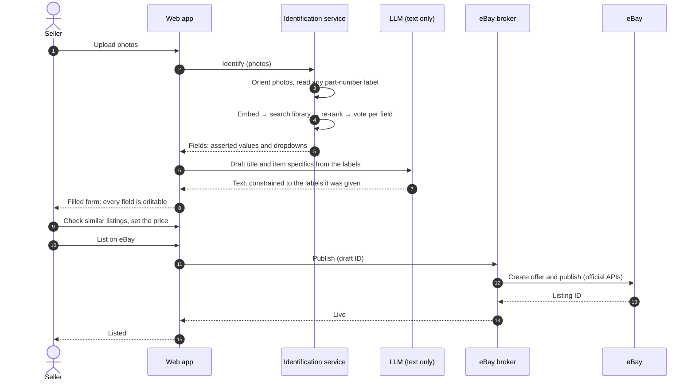

# Architecture

This page follows a part from the workbench to a live eBay listing, then covers the main design decisions
and the trade-offs each one accepted.

## From photo to listing

1. **Photo prep.** Phone photos arrive sideways, upside down and cluttered. They are oriented before
   anything else, and a label photo is read for its part number, which goes into the listing's part
   number field and title.
2. **Identification.** The photos are embedded, compared against the labelled library, and the closest
   matches vote on each field. Low-confidence fields become dropdowns (see below).
3. **Writing the listing.** A language model drafts the text steps, but only from the labels it is
   given. It is never asked what the part is. The description starts from the seller's own template.
4. **Pricing.** The seller sees similar live listings, closest condition first, as plain rows with
   no derived figure, and types a price. Lotwize never suggests one.
5. **Publishing.** A separate broker service talks to eBay's official APIs. A guard stops the same
   draft being published twice while a publish is in flight.

## Design decisions

### Retrieval instead of a classifier

A classifier has to be retrained every time a new generation appears, and it gives one answer even when
it shouldn't. The identifier instead embeds a photo with a fine-tuned vision transformer and looks up the
most similar photos in a labelled library of about 300,000. Each field is decided by a vote among those
neighbours, and closer neighbours count for more.

What this buys:
- **Coverage grows with data.** A newly added generation is searchable as soon as its photos are labelled.
- **Disagreement can be read.** If the closest matches split between two years or two bulb types, that
  is evidence the photos can't settle it, and the right output is a choice for the seller.
- **Every answer can be audited.** It is backed by real listings that look like the part.

What it costs: the library has to be stored and searched. Search is approximate, followed by an
exact re-rank of a shortlist. The full array of stored vectors is memory-mapped from disk, so a query
reads a few hundred kilobytes rather than holding the whole array in RAM.

### Two-stage confidence gating

Every field passes two checks before it is asserted:

1. **Is this a part the library knows?** If even the best match is weak, the identity fields become
   dropdowns with candidates, rather than an empty result.
2. **Do the neighbours agree on this field?** A field is asserted only when the winning value holds a
   clear share of the vote. Otherwise its candidates are offered.

A third layer handles what photos can't decide. Some housings left the factory with several bulb types and
look identical from outside. Some model pairs share a face but not a part. For those cases, expert rules
force a dropdown even when the vote looks confident. A gate like this decides only whether a value is
shown or offered. It can't turn a wrong prediction into a right one, so accuracy problems are fixed at the
source: better coverage, better labels, better retrieval.

### Labels from listing text

The library is labelled automatically from the text of real listings, by a language model reading text
only. **No model looks at a photo to label it.** Captions are noisy, so labels go through cleaning and
consistency checks, and a feature such as "Full LED" is recorded only if that listing's own caption says
so. Precision was chosen over recall here on purpose.

Hand labour goes into the evaluation set instead: about 1,640 headlights checked by hand, which every
change is measured against.

### Separate services by dependency weight

| Service | Holds | Why separate |
|---|---|---|
| Web app | Accounts, drafts, listings, billing, the single-page app | Kept free of ML libraries, so it stays small and quick to deploy. |
| Identification | Vision encoder, vector index, labelled metadata | CPU-only inference on ONNX Runtime. Model files are pinned to an exact version at build time. |
| eBay broker | eBay OAuth and listing operations | Keeps marketplace access behind one narrow interface. |

### Seller in control

- **Two modes.** Balanced asks whenever it isn't sure. Faster fills in its best guess and marks it
  "check this". The seller chooses the trade-off.
- **Nothing is invented.** If the title or the photos don't establish a value, the field stays empty.
- **Nothing goes live without the seller.** Every field can be edited, and only the seller presses List.

## Scale and operations

- **Hosting.** A managed platform runs the web tier and the inference tier as separate services, behind
  Cloudflare.
- **Releases.** Each release pins exact code and model versions together. Rolling back is a configuration
  change, not a rebuild of history.
- **Heavy jobs.** Re-embedding, re-indexing and benchmarks run on rented cloud machines, never on the
  production hosts.
